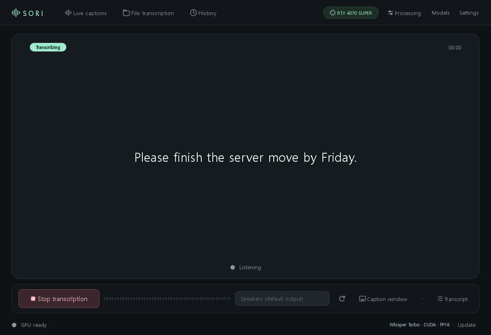
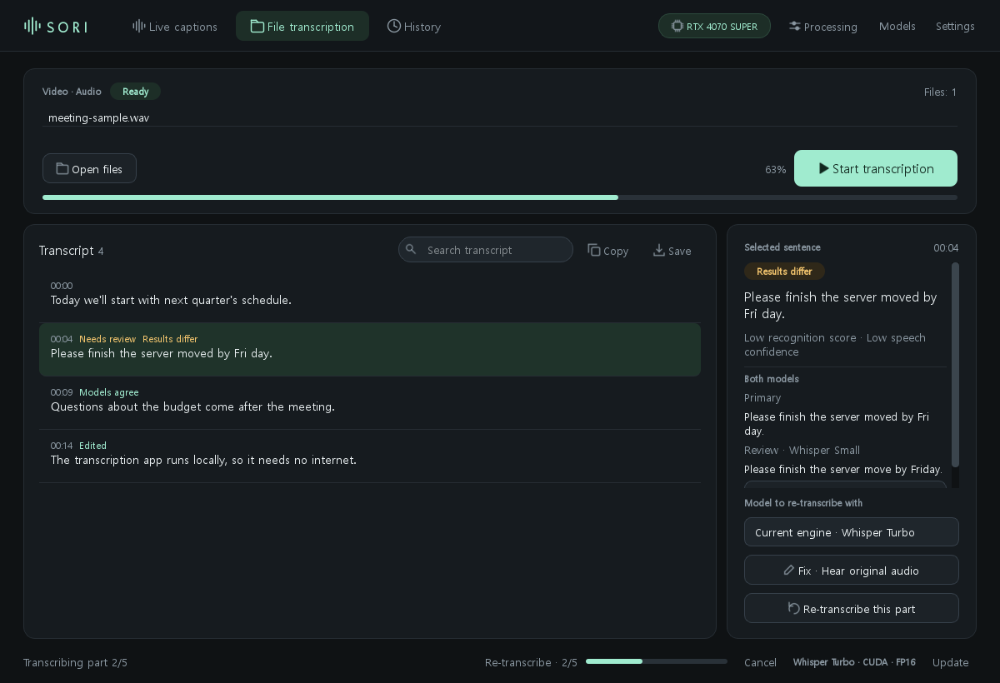

<div align="center">


# SORI

**Local transcription for Windows · live captions, file transcription, search by meaning**

[](https://github.com/Gomtanga/SORI/releases/latest)


[**Download the latest version**](https://github.com/Gomtanga/SORI/releases/latest) · [Changelog](https://github.com/Gomtanga/SORI/releases) · [한국어](README.md)



</div>

## What it does

- 🎧 **Live captions**: captions for whatever your PC plays (meetings, lectures, videos), as it plays. An always-on-top caption window is available too.
- 📁 **File transcription**: turns recordings and videos into timed sentences and saves them as SRT, VTT or text.
- 🔍 **Search by meaning**: finds the part of any saved transcript that means what you ask, even in different words, and jumps to that moment.
- ⚖️ **Two-model comparison**: re-reads low-confidence sentences with a second model and shows both results side by side, so you can pick.
- 🔒 **Stays on your PC**: audio and transcripts never leave it. The internet is used only to download models and to check for updates.

<div align="center">

</div>

## Install

1. Download `SORI-Setup-<version>-x64.exe` from the [release page](https://github.com/Gomtanga/SORI/releases/latest) and run it.
2. If Windows says "Unknown publisher", choose **More info → Run anyway** (the installer is signed with a self-signed certificate).
3. Models are downloaded the first time you use them, after SORI shows their size and source and you agree.

Python is included, so nothing else needs installing. Recordings and models live in `%LOCALAPPDATA%\SORI` and are kept when you update or uninstall. The display language (Korean or English) is in **Settings → Display language**.

## Updates

| Installed version | How |
|---|---|
| **0.5.1 or later** | SORI tells you when a new version is out. One click on **Update** downloads, verifies and installs it. |
| **0.5.0 or earlier** | Download and install the latest release once by hand. Updates are automatic from then on. |

## Models and devices

| Model | Notes | NVIDIA | AMD Radeon² | CPU |
|---|---|:---:|:---:|:---:|
| Whisper Turbo (large-v3-turbo) | Default. Fast and accurate | ✅ | Vulkan | ✅ |
| Whisper Large v3 | Most precise | ✅ | Vulkan | ✅ |
| Whisper Small | Light, for low-end PCs | ✅ | Vulkan | ✅ |
| Whisper Medium Komix v2 | Korean-focused | ✅ | ROCm¹ | ✅ |
| Qwen3-ASR 1.7B | Multilingual, optional word times | ✅ | ROCm¹ | ✅ |

¹ Windows 11, a Radeon RX 7000/9000 series GPU and AMD graphics driver 26.2.2 or later. The first time, SORI asks to install AMD's PyTorch for ROCm (about 2.2 GB). `sori-cli gpu-check` tells you whether a PC is ready.

² The AMD paths are implemented but **not yet confirmed on a real Radeon** (NVIDIA and CPU are checked on a real GPU for every release). If something goes wrong, please report it with the output of `sori-cli gpu-check`.

For search by meaning, besides the built-in search you can choose and download **BGE-M3** (most accurate) or **Multilingual E5 small** (light) inside the app.

## Verify a download

Every release includes `release-manifest.json` with the version, size, SHA-256 and signer thumbprint.

```powershell
Get-FileHash .\SORI-Setup-*-x64.exe -Algorithm SHA256
```

Signing certificate thumbprint: `F4E057B9644DBFB499AD2B3E8508F104EEB5022C`. In-app updates install only when the SHA-256, an intact signature, this thumbprint and the installer's own version information all match.

## Command line and AI agents

The installer includes `sori-cli.exe` and the **SORI Skill** for AI agents such as Codex and Claude (optional during setup). An agent can transcribe files and find "the part of that lecture where VPNs were explained", with the time.

```powershell
$sori = "$env:LOCALAPPDATA\Programs\SORI\sori-cli.exe"
& $sori transcribe "C:\media\lecture.mp4" --format srt -o "C:\media\lecture.srt"
& $sori search "how to encrypt traffic on public Wi-Fi"
```

---

<sub>This repository only distributes the installer. The source code is not here.</sub>
