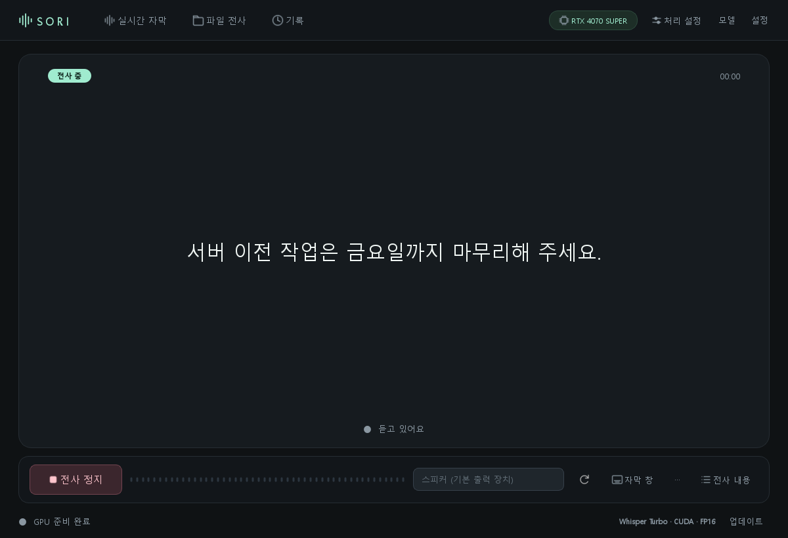
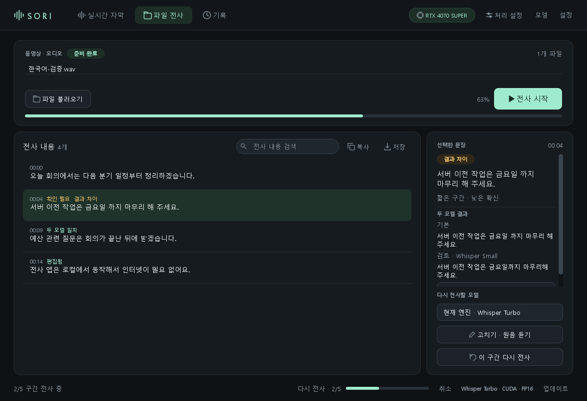

<div align="center">


# SORI

**Windows용 로컬 전사 앱 · 실시간 자막, 파일 전사, 뜻으로 찾기**

[](https://github.com/Gomtanga/SORI/releases/latest)


[**최신 버전 내려받기**](https://github.com/Gomtanga/SORI/releases/latest) · [변경 내역](https://github.com/Gomtanga/SORI/releases)



</div>

## 무엇을 하나요

- 🎧 **실시간 자막**: PC에서 나오는 소리(회의, 강의, 영상)를 바로 자막으로 보여 줍니다. 화면 위에 떠 있는 자막 창도 쓸 수 있습니다.
- 📁 **파일 전사**: 녹음이나 동영상 파일을 문장 단위로 옮기고, SRT·VTT·텍스트로 저장합니다.
- 🔍 **뜻으로 찾기**: 저장한 모든 기록에서 단어가 달라도 뜻이 비슷한 부분을 찾아, 그 시각으로 바로 이동합니다.
- ⚖️ **두 모델 비교**: 확신이 낮은 문장을 다른 모델로 다시 읽어 결과를 나란히 보여 주고, 고를 수 있게 합니다.
- 🔒 **이 PC 안에서만**: 음성과 기록은 밖으로 나가지 않습니다. 인터넷은 모델을 받을 때와 업데이트를 확인할 때만 씁니다.

<div align="center">

</div>

## 설치

1. [릴리스 페이지](https://github.com/Gomtanga/SORI/releases/latest)에서 `SORI-Setup-<버전>-x64.exe`를 받아 실행합니다.
2. Windows가 "알 수 없는 게시자"라고 경고하면 **추가 정보 → 실행**을 누릅니다(자체 서명 인증서라서 나오는 경고입니다).
3. 처음 쓰는 모델은 크기와 출처를 보여 주고 확인을 받은 뒤 내려받습니다.

Python은 설치 파일에 들어 있어 따로 설치할 필요가 없습니다. 기록과 모델은 `%LOCALAPPDATA%\SORI`에 저장되며, 앱을 지우거나 업데이트해도 남습니다.

## 업데이트

| 쓰는 버전 | 방법 |
|---|---|
| **0.5.1 이상** | 앱을 켜면 새 버전을 알려 줍니다. **[업데이트]** 한 번이면 내려받고, 검증하고, 설치합니다. |
| **0.5.0 이하** | 최신 설치 파일을 한 번 직접 받아 설치해 주세요. 그다음부터는 자동입니다. |

## 모델과 처리 장치

| 모델 | 특징 | NVIDIA | AMD Radeon² | CPU |
|---|---|:---:|:---:|:---:|
| Whisper Turbo (large-v3-turbo) | 기본. 빠르고 정확함 | ✅ | Vulkan | ✅ |
| Whisper Large v3 | 가장 정밀함 | ✅ | Vulkan | ✅ |
| Whisper Small | 가벼움, 저사양 PC | ✅ | Vulkan | ✅ |
| Whisper Medium Komix v2 | 한국어 중심 | ✅ | ROCm¹ | ✅ |
| Qwen3-ASR 1.7B | 여러 언어, 단어 시각 선택 | ✅ | ROCm¹ | ✅ |

¹ Windows 11, Radeon RX 7000/9000 계열, AMD 그래픽 드라이버 26.2.2 이상. 처음 쓸 때 AMD 공식 PyTorch(ROCm, 약 2.2GB)를 설치할지 묻습니다. 준비 상태는 `sori-cli gpu-check`로 확인할 수 있습니다.

² AMD GPU 경로는 구현되어 있지만 **아직 실제 Radeon으로 확인하지 못했습니다**(NVIDIA·CPU는 릴리스마다 실제 GPU로 확인합니다). 문제가 있으면 `sori-cli gpu-check` 결과와 함께 알려 주세요.

검색 모델(뜻으로 찾기)은 기본 검색 외에 **BGE-M3**(정확), **Multilingual E5 small**(가벼움)을 앱 안에서 고르고 받을 수 있습니다.

## 파일 확인

릴리스마다 `release-manifest.json`이 함께 올라갑니다. 버전, 크기, SHA-256, 서명자 지문이 들어 있습니다.

```powershell
Get-FileHash .\SORI-Setup-*-x64.exe -Algorithm SHA256
```

서명 인증서 지문: `F4E057B9644DBFB499AD2B3E8508F104EEB5022C`. 앱 안의 업데이트는 SHA-256, 손상되지 않은 서명, 이 지문, 설치 파일의 버전 정보가 모두 맞을 때만 설치합니다.

## 명령줄과 AI 에이전트

설치판에는 `sori-cli.exe`와 AI 에이전트(Codex, Claude 등)용 **SORI Skill**이 함께 들어 있습니다(설치할 때 선택). 에이전트가 파일을 전사하고, 기록에서 "그 강의에서 VPN 설명한 부분"을 시각과 함께 찾을 수 있습니다.

```powershell
$sori = "$env:LOCALAPPDATA\Programs\SORI\sori-cli.exe"
& $sori transcribe "C:\media\lecture.mp4" --format srt -o "C:\media\lecture.srt"
& $sori search "공용 와이파이에서 통신을 암호화하는 방법"
```

<details>
<summary><b>English</b></summary>

**SORI** is a local transcription app for Windows. It shows live captions for system audio, transcribes recordings and videos sentence by sentence, and searches saved transcripts by meaning. It runs Whisper and Qwen3-ASR models on NVIDIA or AMD GPUs or the CPU. Audio and transcripts never leave your PC.

- **Install**: download `SORI-Setup-<version>-x64.exe` from [Releases](https://github.com/Gomtanga/SORI/releases/latest). If Windows shows "Unknown publisher" (self-signed certificate), choose **More info → Run anyway**.
- **Updates**: 0.5.1 or later updates itself with one click. From 0.5.0 or earlier, install the latest release manually once.
- **AMD**: Whisper models use Vulkan; Komix and Qwen3-ASR on Radeon RX 7000/9000 need Windows 11 and AMD driver 26.2.2 or later, and SORI installs AMD's PyTorch for ROCm (about 2.2 GB) when first needed. Check with `sori-cli gpu-check`. The AMD paths have not been confirmed on a real Radeon yet.
- **Verify**: each release ships `release-manifest.json` (version, size, SHA-256, signer thumbprint `F4E057B9644DBFB499AD2B3E8508F104EEB5022C`).

</details>

---

<sub>이 저장소는 설치 파일 배포 전용입니다. 소스 코드는 여기에 없습니다.</sub>
